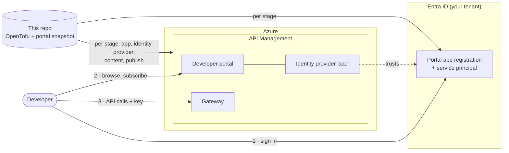
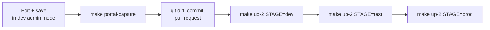
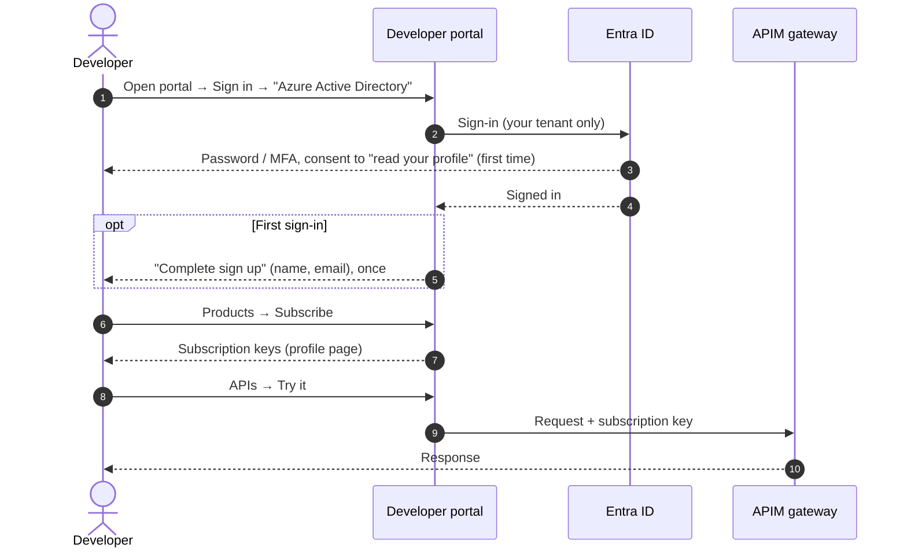

# Azure API Management: developer portal as code

You run Azure API Management and want to switch on the **developer portal** for your API consumers, enterprise-ready:

- sign-in with **Microsoft Entra ID** only (no local accounts),
- the portal's look **versioned in git**,
- changes **promoted from dev to prod** like any other code.

This repository is a working reference built with OpenTofu and Microsoft's official portal scripts.

| Question | Short answer |
| --- | --- |
| [Which tier do I need?](#1-which-tier-do-i-need) | Standard v2 or Premium (v2) for production; Developer is fine for non-prod stages |
| [How do I set it up?](#3-set-up-the-portal-on-your-apim-instance) | Open the portal once in the Azure portal, then `make up-2 STAGE=<stage>` |
| [How do I administer it?](#4-administer-the-portal) | Design in dev, roles per task, access controlled through Entra |
| [How do I go from one stage to the next?](#5-promote-changes-from-dev-to-prod) | `make portal-capture` in dev, commit, `make up-2 STAGE=prod` |
| [What do developers experience?](#6-developer-journey) | Sign in with their work account, subscribe, try the API |

## 1. Which tier do I need?

| Tier | Developer portal | Entra ID sign-in | SLA | Use it for |
| --- | --- | --- | --- | --- |
| Consumption | – | – | yes | not an option |
| Basic (classic) | yes | – | yes | not an option (no Entra sign-in) |
| Developer | yes | yes | **none** | dev/test stages only |
| Basic v2 | yes | yes | yes | small production, public network |
| **Standard v2** | yes | yes | yes | production; outbound VNet integration, availability zones |
| **Premium v2** | yes | yes | yes | production with full VNet injection (private), availability zones |
| Premium (classic) | yes | yes | yes | multi-region, or users from **several Entra tenants** |

**Recommendation:** Standard v2 for most production setups, Premium v2 when the gateway and portal must be private, Premium (classic) for multi-region or multi-tenant sign-in. Use Developer for dev/test to save cost. v2 tiers are not available in every region, and the features change; check Microsoft's [feature comparison](https://learn.microsoft.com/azure/api-management/api-management-features) and [v2 availability](https://learn.microsoft.com/azure/api-management/api-management-region-availability) before you decide.

## 2. How it works



Per stage (dev, test, prod, …), `make up-2` does the following:

1. **Entra ID:** creates an app registration with a service principal and a client secret. Single tenant only, optionally restricted to Entra groups.
2. **APIM identity provider:** points the instance's `aad` identity provider at that app, and turns email/password sign-up off.
3. **Portal content:** imports pages, styles and images from the snapshot in `02-portal/content/` (Microsoft's `cleanup.js` + `generate.js`).
4. **Publish:** publishes the portal and waits until publishing has finished.

Everything is OpenTofu with encrypted state. The snapshot is the single source for the portal's look in every stage.

## 3. Set up the portal on your APIM instance

**You need:**
- **Azure:** API Management Service Contributor on the instance.
- **Entra:** the right to create app registrations (on by default, otherwise the Application Developer role).
- **Tools:** `az` (signed in), OpenTofu 1.13, GNU Make, `jq`, Node.js 20+.

**Steps:**

1. **Configure the repo** (once):
   ```bash
   cp .env.example .env                                               # state encryption passphrase
   cp 02-portal/terraform.tfvars.example 02-portal/terraform.tfvars   # subscription_id, tenant_id
   cp 02-portal/stages/example.tfvars.example 02-portal/stages/dev.tfvars
   ```
   In `stages/dev.tfvars`, set `resource_group_name`, `apim_name` and `developer_portal_url` of your instance. Repeat with `test.tfvars`, `prod.tfvars` for other stages.
2. **Initialize the portal** (once per instance): Azure portal → APIM instance → *Developer portal* → *Developer portal* at the top. Wait until the editor has loaded, close the tab. Only then does the instance have portal content.
3. **Keep or replace the current look:** `make up-2` replaces the instance's portal content with the snapshot in the repo. To keep the look the instance has today, run `make portal-capture STAGE=dev` first and commit.
4. **Deploy:** `make up-2 STAGE=dev`. Review the plan and confirm.
5. **Check:** open the portal URL in a private window → *Sign in* → *Azure Active Directory* → sign in with a test user who is not a subscription owner. A personal Microsoft account must be rejected.

APIs and products are still configured the way you already do it. Developers see a product once it is visible to the built-in group `developers`.

## 4. Administer the portal

**Who needs what:**

| Task | Azure role on the APIM instance | Entra |
| --- | --- | --- |
| Design the portal (admin mode), run `make portal-capture` | API Management Developer Portal Content Editor (least privilege) or API Management Service Contributor | – |
| Deploy with `make up-2` | API Management Service Contributor | create app registrations |
| Grant consent, if users may not consent themselves | – | Cloud Application Administrator |
| Sign in as a developer | none | member of the tenant (or of an allowed group) |

**Day to day:**
- **Change the look** only in dev, in admin mode (Azure portal → APIM → *Developer portal*), then promote it ([section 5](#5-promote-changes-from-dev-to-prod)). Save in the editor, but don't publish there.
- **Control who can sign in** in the stage file: `sign_in_group_ids = ["<group object id>"]` limits sign-in to members of these Entra groups (needs Entra ID P1). Without it, every member of the tenant can sign in.
- **Control what developers see** with APIM products and groups. Portal users show up in APIM under *Users*.
- **Rotate the client secret** (90 days by default): `tofu -chdir=02-portal apply -var-file=stages/<stage>.tfvars -replace=time_offset.secret_expiry` (select the workspace first for stages other than dev, see [reference](docs/reference.md#stages-and-state)).
- **Check for drift:** `make plan STAGE=<stage>`.

Authentication flows, components and the full permission list: [docs/reference.md](docs/reference.md).

## 5. Promote changes from dev to prod



1. **Edit in dev** and save. Don't publish in the editor.
2. **Capture:** `make portal-capture` writes the dev portal into `02-portal/content/`: `data.json` holds pages, styles and navigation, `media/` holds uploaded images.
3. **Review:** `git diff`, commit on a branch, pull request. The diff shows exactly what changed.
4. **Deploy stage by stage:** `make up-2 STAGE=dev`, then `STAGE=test`, then `STAGE=prod`. Each run replaces that stage's portal content with the snapshot and publishes it. Check each stage before moving on.
5. **Roll back:** `git revert` the commit and deploy again.

**Rules:**
- **Never edit test or prod in admin mode.** The next deployment overwrites those edits, because deploying replaces content and never merges it.
- **Capture right after editing dev.** An unrelated deployment to dev overwrites uncaptured edits.
- The snapshot contains no stage-specific values. Sign-in, secrets and identity provider are created per stage.

## 6. Developer journey



1. **Sign in** with the work account. On the first sign-in, Entra may ask for consent to "Sign you in and read your profile". The portal then asks once for name and email ("Complete sign up"); the values are prefilled from the Entra profile when they are set there.
2. **Subscribe** to a product. The keys are on the profile page.
3. **Try the API** in the portal ("Try it" fills in the key), then call it from code with the header `Ocp-Apim-Subscription-Key`.

Accounts from other tenants and personal Microsoft accounts are rejected. If the very first sign-in attempt fails with `timed_out`, a second attempt works.

## 7. Enterprise checklist

This repo is a reference. For production, also plan for:

- [ ] **Remote state:** the repo uses local, encrypted state. Use a remote backend instead, e.g. Azure Storage with locking.
- [ ] **CI/CD:** run `make up-2 STAGE=…` from a pipeline with workload identity federation (OIDC) instead of from a laptop, with an approval gate before prod.
- [ ] **Sign-in scope:** set `sign_in_group_ids`, and apply Conditional Access policies to the portal app.
- [ ] **Consent:** grant admin consent for `User.Read` if users may not consent themselves.
- [ ] **Custom domain** for the portal (`developer.contoso.com`): set `developer_portal_url` in the stage file to it; the Entra redirect URI follows.
- [ ] **Secret rotation** before the 90 days run out.
- [ ] **Media in git:** use Git LFS if the portal uses many or large images.

## More

| Document | Content |
| --- | --- |
| [docs/reference.md](docs/reference.md) | Components, authentication flows, permissions, stages and state, how content and media are captured and applied, Microsoft's scripts and updates, make targets, repository layout |
| [docs/demo-apim.md](docs/demo-apim.md) | Optional: deploy a demo APIM instance (Developer tier) with a CRUD API on Table Storage, to try all of the above without an existing instance |
