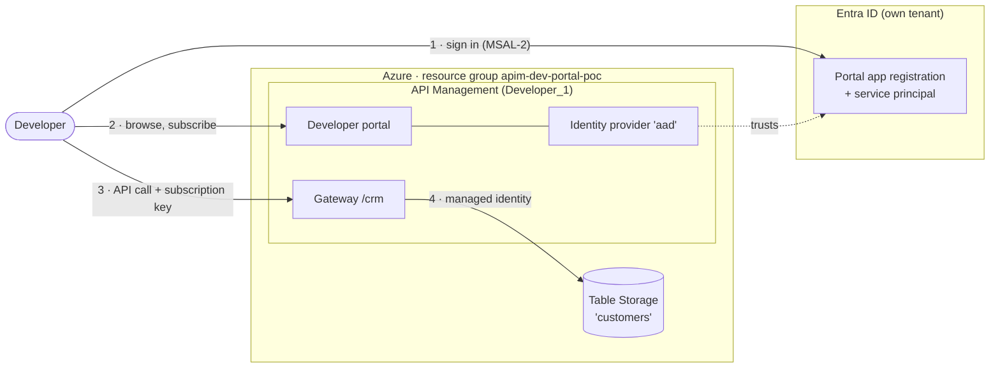
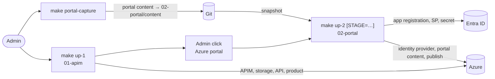

# APIM Developer Portal PoC

Proof of concept for the Azure API Management developer portal, built entirely with OpenTofu:

- **Developer portal with Entra ID sign-in**, restricted to accounts of your own tenant, no email/password registration.
- **Portal look as code**: pages, styles and images live as a snapshot in this repo and are deployed from dev to prod with Microsoft's official portal scripts.
- **Customers API with full CRUD** behind the portal, mapped by APIM policies directly onto Azure Table Storage. There is no backend code.

> **Status:** PoC, demo data only. See [Security posture](docs/apim.md#security-posture).

## Documentation

| Part | Covers |
| --- | --- |
| [**Part 1: Developer portal**](docs/developer-portal.md) | Entra sign-in, authentication flows, permissions, portal content as code, stages, and three user journeys: [setting up the portal on an existing APIM instance](docs/developer-portal.md#journey-1-admin-sets-up-the-portal-on-an-existing-apim-instance), [deploying a portal change from dev to prod](docs/developer-portal.md#journey-2-admin-changes-the-portal-in-dev-and-deploys-it-to-prod), [a developer's first visit](docs/developer-portal.md#journey-3-developer-uses-the-portal-for-the-first-time) |
| [**Part 2: APIM instance and API**](docs/apim.md) | Resources, request flow, deployment of the dev instance, permissions, API, policies, design decisions, operations |

## Architecture

**Runtime:** what a developer touches.



**Deployment:** what an admin runs.



## Quick start

Prerequisites: `az login` with access to the subscription, OpenTofu 1.13, GNU Make, `curl`, `jq`, `xmllint`, Node.js 20+. Permissions: see [Part 1](docs/developer-portal.md#permissions) and [Part 2](docs/apim.md#permissions).

```bash
cp .env.example .env                                         # set TF_VAR_state_passphrase (16+ chars)
cp 01-apim/terraform.tfvars.example 01-apim/terraform.tfvars       # subscription_id, publisher_email
cp 02-portal/terraform.tfvars.example 02-portal/terraform.tfvars   # subscription_id, tenant_id

make up-1     # APIM instance, storage, API, product (30-60 min)
make smoke    # 20 checks against the gateway
# Admin click: Azure portal → APIM → Developer portal → "Developer portal" (once per instance)
make up-2     # Entra app, identity provider, portal content, publish
```

**Cost:** APIM Developer tier costs about $0.07 per hour (roughly $50 per month) while it exists. Run `make down` when you are done.

## Make targets

| Target | What it does |
| --- | --- |
| `make up-1` | Deploy the APIM instance and API (`01-apim`) |
| `make smoke` | Check the API through the gateway |
| `make up-2 [STAGE=prod]` | Deploy the portal part (`02-portal`) for a stage |
| `make portal-capture [STAGE=dev]` | Export the portal content of a stage's instance to `02-portal/content/` |
| `make portal-tools-update [REF=<tag>]` | Update Microsoft's vendored portal scripts |
| `make plan [STAGE=prod]` | Drift check, fails on changes |
| `make lint` | Static checks, no Azure access |
| `make down` / `make down-2 [STAGE=prod]` | Teardown |

## Repository layout

```text
01-apim/                 Part 2: RG, storage + seed data, APIM, API, policies, product
  api/                   OpenAPI contract of the Customers API
  policies/              Policy XML (API scope, per operation, product)
02-portal/               Part 1: Entra app, identity provider, portal content, publishing
  content/               Snapshot of the portal content (data.json + media/)
  stages/                Per-stage instance values for existing instances (prod.tfvars.example)
docs/                    Part 1 and Part 2 documentation
scripts/                 Smoke test, preflight, publish, portal content capture/apply
tools/portal-content/    Microsoft's portal scripts (vendor/, pinned release) + update script
Makefile                 Workflow
```
