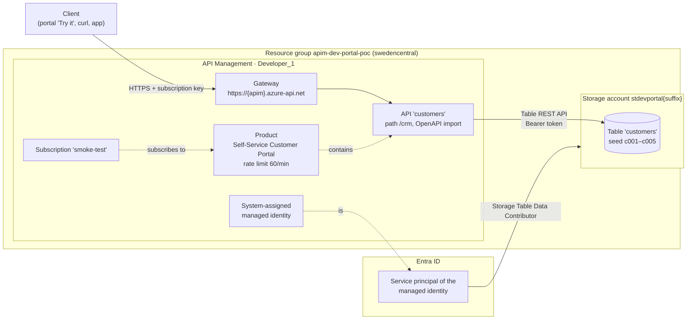
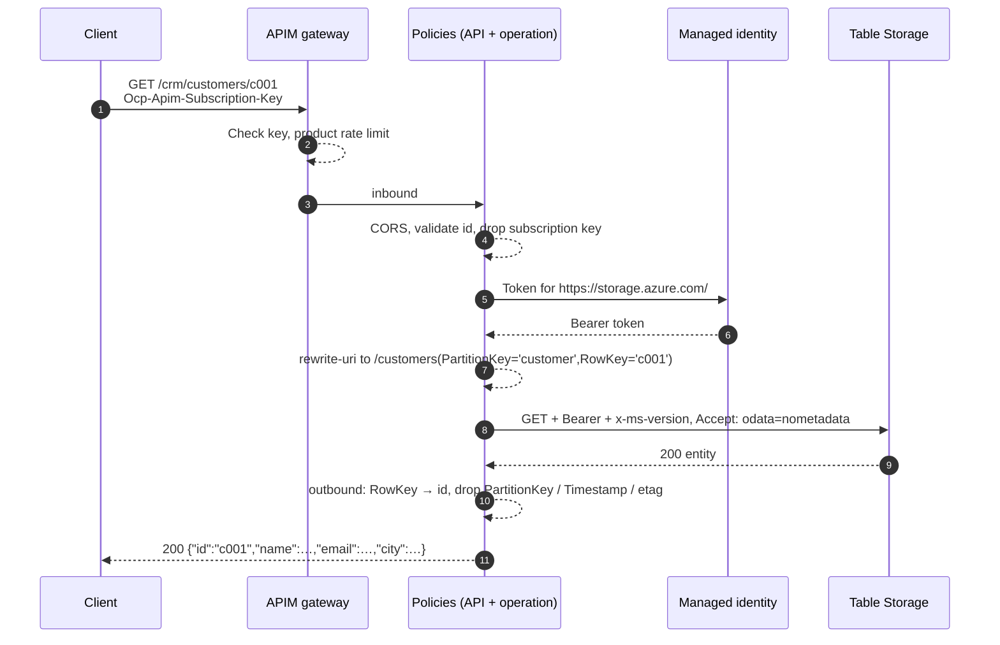
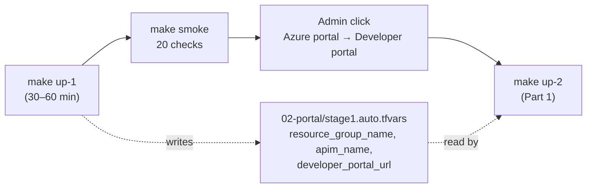

# Part 2: APIM instance and Customers API

This part covers the API Management instance (the dev stage), the Customers API and how it talks to Table Storage. It is deployed by the OpenTofu root `01-apim/`. The developer portal on top of it is covered in [Part 1](developer-portal.md).

- [Architecture](#architecture)
- [Request flow](#request-flow)
- [Deployment](#deployment)
- [Permissions](#permissions)
- [API](#api)
- [Policies](#policies)
- [Design decisions](#design-decisions)
- [Operations and known quirks](#operations-and-known-quirks)
- [Security posture](#security-posture)

## Architecture



| Resource | Name | Notes |
| --- | --- | --- |
| Resource group | `apim-dev-portal-poc` | swedencentral |
| API Management | `apim-devportal-poc-<suffix>` | Developer_1, system-assigned managed identity, sign-up off |
| Storage account | `stdevportal<suffix>` | Standard LRS, TLS 1.2, table `customers` with 5 seed rows |
| Role assignment | Storage Table Data Contributor | APIM's managed identity on the storage account |
| API | `customers`, path `/crm` | imported from `01-apim/api/customers.openapi.yaml`, policies from `01-apim/policies/` |
| Product | `self-service-customer-portal` | visible to group `developers`, no approval, 1 subscription per user, 60 calls/min |
| Subscription | `smoke-test` | key is used only by `make smoke` |

The random `<suffix>` keeps global names (APIM, storage) unique.

## Request flow



## Deployment



1. **Setup** (once):
   - Copy `.env.example` to `.env` and set a passphrase for state encryption (at least 16 characters). The `Makefile` loads it automatically; for direct `tofu` calls run `set -a; . ./.env; set +a` first.
   - Copy `01-apim/terraform.tfvars.example` to `01-apim/terraform.tfvars` and fill in `subscription_id` and `publisher_email`.
2. **`make up-1`** creates resource group, storage account with seed data, APIM, role assignment, API, policies, product and smoke subscription. Creating APIM takes 30–60 minutes; on macOS the apply runs under `caffeinate`. Afterwards it writes `02-portal/stage1.auto.tfvars` for Part 1.
3. **`make smoke`** runs 20 checks against the gateway (CRUD, validation, 404s, CORS preflight, missing key). Right after `up-1` it retries on 403 for up to 10 minutes while the role assignment becomes effective.
4. Continue with the portal: [Journey 1](developer-portal.md#journey-1-admin-sets-up-the-portal-on-an-existing-apim-instance).

`apply` and `destroy` ask for confirmation; `AUTO_APPROVE=1` skips it.

## Permissions

| Who / what | Needs | Scope | Why |
| --- | --- | --- | --- |
| Admin running `make up-1` / `make down` | **Contributor** | subscription (creates the resource group) | Create/delete RG, APIM, storage account, table, API, product, subscription |
| Admin running `make up-1` | **Role Based Access Control Administrator** or **User Access Administrator** (or simply **Owner** instead of both rows) | subscription or resource group | Create the role assignment for APIM's managed identity on the storage account |
| Admin running `make up-1` | Storage account keys (included in Contributor) | storage account | `azurerm_storage_table_entity` writes the seed rows with the shared key |
| Admin running `make smoke` | Read the OpenTofu outputs (state passphrase) | – | Gateway URL and smoke key come from the encrypted state |
| APIM managed identity | **Storage Table Data Contributor** | storage account | Read and write table rows |
| API clients | A subscription key for the product | – | No Azure permissions |

## API

| Operation | Request | Success | Errors |
| --- | --- | --- | --- |
| `listCustomers` | `GET /crm/customers` | 200, array (at most 1000) | 401, 429 |
| `getCustomer` | `GET /crm/customers/{id}` | 200 | 400 invalid id, 404 |
| `createCustomer` | `POST /crm/customers` with `{"name","email","city?"}` | 201 + `Location` | 400 invalid body |
| `replaceCustomer` | `PUT /crm/customers/{id}` with `{"name","email","city?"}` | 200 + customer | 400, 404 |
| `deleteCustomer` | `DELETE /crm/customers/{id}` | 204 | 400, 404 |

- `id`: `^[A-Za-z0-9-]{1,64}$`. Seed customers `c001`–`c005` (`c005` intentionally has no `city`); new customers get a GUID.
- `name`, `email` required, `city` optional, no other fields allowed, body at most 4 KB.

```bash
curl -H "Ocp-Apim-Subscription-Key: <key>" "$(tofu -chdir=01-apim output -raw gateway_url)/crm/customers"
```

## Policies

| Scope | File | What it does |
| --- | --- | --- |
| API | `policies/api.xml.tftpl` | CORS for the portal origin (all headers), `validate-parameters`, removes the subscription key (header and query), managed identity token for storage, Table Storage headers (`x-ms-version`, `x-ms-date`, `Accept: odata=nometadata`), backend = table endpoint |
| Operation | `list-customers.xml` | `rewrite-uri` to the table query with `$select`, unwrap `value`, `RowKey` → `id` |
| Operation | `get-customer.xml` | `rewrite-uri` to the entity, map the response |
| Operation | `create-customer.xml` | `validate-content`, new GUID, build the entity (`PartitionKey`/`RowKey` set by APIM), `Prefer: return-content`, `Location` header |
| Operation | `replace-customer.xml` | `validate-content`, build the entity, `If-Match: *`, turn storage's 204 into 200 with the customer |
| Operation | `delete-customer.xml` | `If-Match: *`, `rewrite-uri` to the entity |
| Product | `product.xml` | `rate-limit` 60 calls / 60 s per subscription |

Every `rewrite-uri` uses `copy-unmatched-params="false"`, so clients cannot pass `$filter`, `$top` etc. through to storage.

## Design decisions

- **Developer tier:** the cheapest tier with a developer portal. Consumption has no portal, Basic v2 costs more. No SLA, single unit, fine for a PoC.
- **No backend code:** the policies translate the REST calls into Table Storage REST API calls and authenticate with APIM's managed identity. No Function App, no code deployment, no secrets for storage.
- **Hardened policies:**
  - The `id` pattern stops OData injection via quotes or parentheses.
  - `PartitionKey`/`RowKey` are always set by the policy, never by the client.
  - Unknown fields and bodies over 4 KB are rejected.
  - `If-Match: *` makes PUT/DELETE on an unknown `id` return 404 instead of upserting.
  - The subscription key is never forwarded to storage.
- **Two OpenTofu roots:** after APIM is created, the developer portal needs a manual admin click before it has content. Part 2 (`01-apim`) and Part 1 (`02-portal`) are therefore separate roots. They exchange only three values via the generated `02-portal/stage1.auto.tfvars`; there is no `terraform_remote_state`, because Part 1 would otherwise have to configure Part 2's state encryption as well.
- **Local, encrypted state:** OpenTofu native state encryption (pbkdf2 + AES-GCM, enforced for state and plan), passphrase from `TF_VAR_state_passphrase`.
- **Soft delete:** the azurerm provider purges APIM on destroy and recovers soft-deleted instances on create, so the same name can be rebuilt immediately.

## Operations and known quirks

- **Drift:** `make plan` (checks `01-apim` and the dev portal stage).
- **Static checks:** `make lint` (fmt, validate, XML, shell syntax, snapshot JSON), no Azure access needed.
- **Troubleshooting:** Azure portal → APIM → APIs → Customers API → operation → "Test" tab → "Trace".
- Right after `up-1`, calls may return **403** for a few minutes until the role assignment is effective.
- Applying `01-apim` resets **only the five seed customers**. Customers created through the API stay. A seed customer changed through the API shows up as a change in `make plan`.
- CORS allows all request headers, because the portal's test console may send `Ocp-Apim-Trace` or `Cache-Control`; with a fixed header list, "Try it" fails with a CORS error. The `cors` policy at API scope answers the preflight without an OPTIONS operation.
- The API's `description` is set in `api.tf` as well, because APIM copies it from the OpenAPI file on import; otherwise `make plan` reports drift.
- The smoke subscription pins `allow_tracing = false`, because Azure turns tracing off by itself; otherwise `make plan` reports drift.
- Errors (404, 409) are passed through unchanged in Table Storage's OData format.
- APIM creates the Starter and Unlimited products automatically. `developers` is an APIM group, not an Entra group.

**Teardown:**

```bash
make down     # first 02-portal (dev stage), then 01-apim (RG incl. APIM, purged)
```

`down-1` refuses to run while the dev portal stage still has resources. Other portal stages (`STAGE=prod`) point to instances this repo does not own and are torn down separately with `make down-2 STAGE=<stage>`.

**Recovery:**
- **Passphrase lost:** the states can no longer be read. Delete the resource group `apim-dev-portal-poc` and the app registration(s) `apim-dev-portal-poc-portal*` manually.
- **01 torn down before 02 by mistake:** run `tofu -chdir=02-portal state rm <address>` for every address from `tofu -chdir=02-portal state list`, then delete the app registration manually.

## Security posture

- Demo data only: anyone with a subscription key can read, change and delete all customers.
- The storage account is publicly reachable and has shared key access enabled, because seeding via azurerm needs it.
- The client secret of the portal app is stored in the encrypted state and in the APIM identity provider configuration.
- Possible next step: protect the API with Entra tokens (`validate-jwt` at API scope, a second app registration, OAuth in the test console). Product, group and operations stay unchanged.
