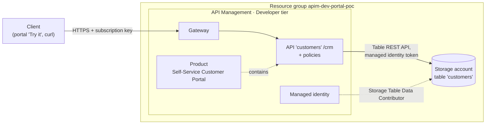

# Optional: demo APIM instance

Only needed if you want to try the portal setup without an existing APIM instance. `01-apim/` deploys a small, cheap instance with one working API. It then serves as the `dev` stage for the [README](../README.md).

- [What gets deployed](#what-gets-deployed)
- [Deploy](#deploy)
- [The Customers API](#the-customers-api)
- [Permissions](#permissions)
- [Operations and teardown](#operations-and-teardown)

## What gets deployed



| Resource | Notes |
| --- | --- |
| API Management `apim-devportal-poc-<suffix>` | Developer tier (no SLA, about $0.07/hour), swedencentral, system-assigned managed identity |
| Storage account `stdevportal<suffix>` | table `customers` with five seed rows |
| API `customers`, path `/crm` | from `01-apim/api/customers.openapi.yaml`, policies in `01-apim/policies/` |
| Product "Self-Service Customer Portal" | visible to `developers`, no approval, one subscription per user, 60 calls/min |
| Subscription `smoke-test` | used by `make smoke` |

There is no backend code: the policies translate the REST calls into Table Storage REST calls, authenticated with APIM's managed identity.

## Deploy

```bash
cp .env.example .env                                           # state passphrase
cp 01-apim/terraform.tfvars.example 01-apim/terraform.tfvars   # subscription_id, publisher_email
make up-1     # 30-60 min; writes 02-portal/stages/dev.tfvars
make smoke    # 20 checks against the gateway
```

Then continue with [README section 3](../README.md#3-set-up-the-portal-on-your-apim-instance) from step 2. Right after `up-1`, calls may return 403 for a few minutes until the role assignment is effective; `make smoke` waits for that.

## The Customers API

| Operation | Request | Success |
| --- | --- | --- |
| List | `GET /crm/customers` | 200 (at most 1000) |
| Get | `GET /crm/customers/{id}` | 200 |
| Create | `POST /crm/customers` with `{"name","email","city?"}` | 201 + `Location` |
| Replace | `PUT /crm/customers/{id}` | 200 |
| Delete | `DELETE /crm/customers/{id}` | 204 |

```bash
curl -H "Ocp-Apim-Subscription-Key: <key>" "$(tofu -chdir=01-apim output -raw gateway_url)/crm/customers"
```

The policies protect the table:
- `id` must match `^[A-Za-z0-9-]{1,64}$`, which prevents OData injection.
- Unknown fields and bodies over 4 KB are rejected.
- `PartitionKey`/`RowKey` are always set by APIM.
- Client query parameters are not passed on to storage.
- PUT/DELETE on an unknown `id` return 404 instead of creating rows.
- The subscription key is not forwarded.
- Errors from Table Storage (404, 409) are passed through in OData format.

## Permissions

| Who | Needs | Why |
| --- | --- | --- |
| Admin running `make up-1` / `make down` | Contributor on the subscription | Create/delete the resource group and everything in it |
| Admin running `make up-1` | Role Based Access Control Administrator or User Access Administrator (or Owner instead of both) | Role assignment for APIM's managed identity on the storage account |
| APIM managed identity | Storage Table Data Contributor on the storage account | Read/write rows |

## Operations and teardown

- **Drift check:** `make plan-apim`. A seed customer changed through the API shows up as a change; `make up-1` resets the five seed rows.
- **Troubleshooting:** Azure portal → APIM → APIs → Customers API → operation → *Test* → *Trace*.
- **Teardown:** `make down` removes the dev portal part, then the resource group including APIM (purged, so the name is free again immediately). Cost stops then.

Security: demo data only. Anyone with a subscription key can read and change all customers. The storage account is public and has shared key access enabled, because seeding through azurerm needs it.
