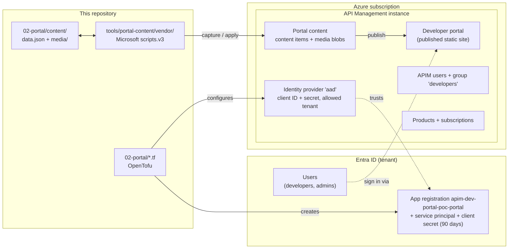
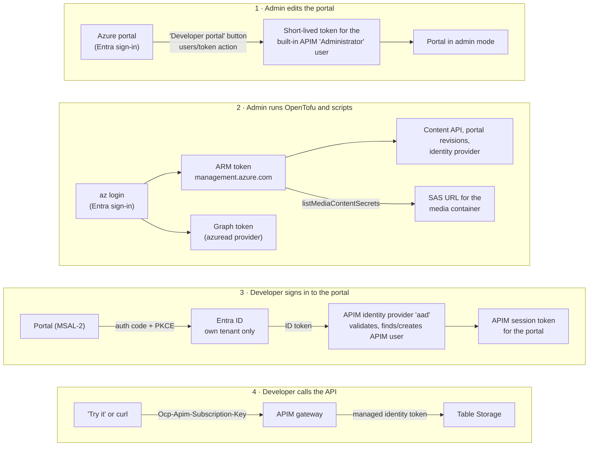
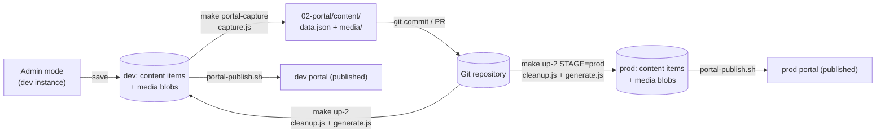
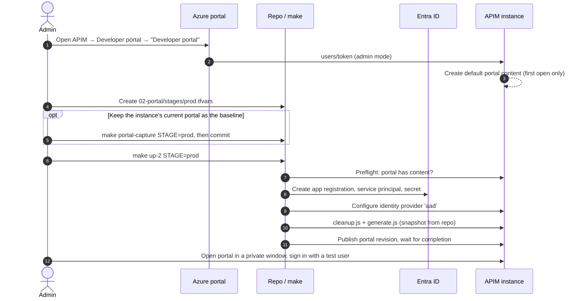
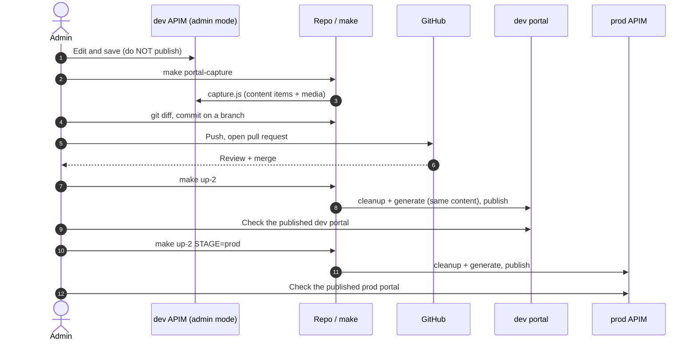
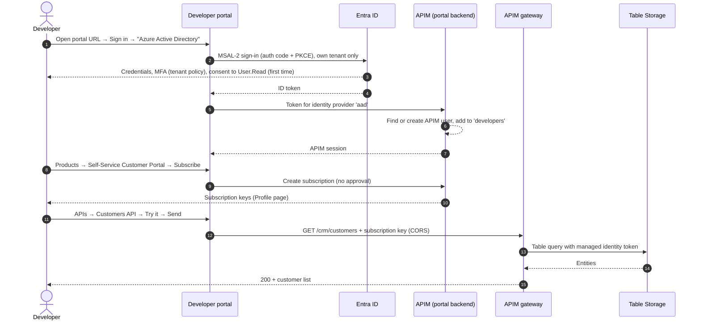

# Part 1: Developer portal

This part covers the APIM developer portal: Entra ID sign-in, the portal's look as code, deployment from dev to prod, and the three main user journeys. The APIM instance and the API behind the portal are covered in [Part 2](apim.md).

- [Components](#components)
- [Authentication](#authentication)
- [Permissions](#permissions)
- [Portal content as code](#portal-content-as-code)
- [Journey 1: Admin sets up the portal on an existing APIM instance](#journey-1-admin-sets-up-the-portal-on-an-existing-apim-instance)
- [Journey 2: Admin changes the portal in dev and deploys it to prod](#journey-2-admin-changes-the-portal-in-dev-and-deploys-it-to-prod)
- [Journey 3: Developer uses the portal for the first time](#journey-3-developer-uses-the-portal-for-the-first-time)
- [Microsoft's scripts and updates](#microsofts-scripts-and-updates)
- [Operations and known quirks](#operations-and-known-quirks)

## Components



| Where | Component | Created by |
| --- | --- | --- |
| Entra ID | App registration `apim-dev-portal-poc-portal` (other stages: `…-portal-<stage>`), single tenant, SPA redirect URI `<portal>/signin`, delegated permission Microsoft Graph `User.Read` | `02-portal/entra.tf` |
| Entra ID | Service principal of the app (shows up under "Enterprise applications") | `02-portal/entra.tf` |
| Entra ID | Client secret of the app, valid for 90 days | `02-portal/entra.tf` |
| Entra ID | Users who sign in to the portal (members of the tenant) | manually / your identity process |
| Entra ID | System-assigned managed identity of APIM (used for Table Storage, see Part 2) | `01-apim` |
| Azure | APIM identity provider `aad` (client ID, secret, MSAL-2, sign-in tenant = allowed tenant = own tenant) | `02-portal/portal.tf` |
| Azure | Sign-up setting (off: no email/password registration) | `01-apim/apim.tf` |
| Azure | Portal content (pages, layouts, styles, navigation) and media, stored inside APIM | admin mode + `make portal-capture` / `make up-2` |
| Azure | APIM users and the built-in group `developers`, created on a developer's first sign-in | APIM |
| Azure | Portal revision (the published static site) | `scripts/portal-publish.sh` |

## Authentication

Four different sign-ins are involved. They use different identities and tokens:



1. **Admin edits the portal.** The admin signs in to the Azure portal with Entra ID. The "Developer portal" button asks APIM for a short-lived token for APIM's built-in *Administrator* user (permission `Microsoft.ApiManagement/service/users/token/action`) and opens the portal in admin mode. Inside the editor, the admin acts as that APIM user, not as their Entra identity.
2. **Admin runs OpenTofu and the scripts.** `az login` gives the Azure CLI a token. OpenTofu's azurerm/azuread providers and the scripts use it: ARM tokens for `management.azure.com` (content items, portal revisions, identity provider) and Graph tokens for the app registration. The media files are read and written with a short-lived SAS URL that APIM hands out via `portalconfigs/default/listMediaContentSecrets`.
3. **Developer signs in.** The portal uses MSAL-2 (authorization code flow with PKCE) against `login.microsoftonline.com/<tenant>` with the app registration's client ID. Only the own tenant is allowed (`AzureADMyOrg` on the app, `allowed_tenants` on the identity provider), so personal Microsoft accounts and other tenants are rejected. APIM validates the returned token against the identity provider configuration, finds or creates the APIM user (member of `developers`), and the portal continues with an APIM session token.
4. **Developer calls the API.** Calls use the subscription key of the developer's own subscription. The portal's "Try it" sends them from the browser straight to the gateway, which is why CORS is configured. Behind the gateway, APIM uses its managed identity for Table Storage (see [Part 2](apim.md#request-flow)).

## Permissions

| Who / what | Needs | Scope | Why |
| --- | --- | --- | --- |
| Admin running `make up-2` | **API Management Service Contributor** | APIM instance (or its RG) | Read the instance, configure the identity provider, apply portal content (`contentTypes/*`, `listMediaContentSecrets`), publish (`portalRevisions`) |
| Admin running `make up-2` | Allowed to **create app registrations**: the tenant setting "Users can register applications" (on by default), otherwise the **Application Developer** role | Entra tenant | Create app registration, service principal and secret (the admin becomes owner) |
| Admin running `make portal-capture` | API Management Service Contributor, or **API Management Developer Portal Content Editor** | APIM instance | Read content items, get the media SAS URL |
| Admin editing in admin mode | API Management Service Contributor, or **API Management Developer Portal Content Editor** | APIM instance | The "Developer portal" button needs `users/token/action` on the instance |
| First admin-mode open of a new instance (the "admin click") | API Management Service Contributor (or Owner/Contributor) | APIM instance | Initializes the default portal content |
| Developer | Member of the tenant, can consent to `User.Read` | Entra tenant | Sign-in. If user consent is disabled in the tenant, an admin (Cloud Application Administrator or Application Administrator) grants admin consent for the app once. |
| Developer | Nothing in Azure RBAC | – | Developers are APIM users, not Azure principals |

The *Developer Portal Content Editor* role is the least-privilege option for people who only design the portal. It was not tested with the scripts in this repo; the scripts were tested with Owner.

## Portal content as code

APIM stores pages, layouts, colors, fonts, navigation and images as "content items" and media blobs. The azurerm provider has no resources for them, so the content lives in the repo as a snapshot:

```text
02-portal/content/data.json   all content items (sorted and indented for readable diffs)
02-portal/content/media/      uploaded images and files (+ .info with the content type)
```



- **Capture** (`make portal-capture`) reads every content item into `data.json` and downloads every media blob into `media/<blobId>` (+ `.info` with the content type). `media/` is wiped first, so images deleted in the portal disappear from the snapshot too.
- **Apply** (part of `make up-2`, only when the snapshot changed) runs Microsoft's `cleanup.js` (deletes **all** content items and **all** media blobs in the target) and `generate.js` (recreates the content items and uploads the media under the same IDs). References between pages and images stay valid.
- **Publish** (`scripts/portal-publish.sh`) creates a new portal revision and waits until it has completed. Images are then served under their `permalink`, e.g. `https://<portal>/content/<fileName>`.

> **Applying replaces, it never merges.** Edits made in the editor of an instance are lost the next time a changed snapshot is applied to it. Only edit in dev, and capture before you apply.

Notes:
- The snapshot contains no instance-specific values (host names, client IDs), so the same snapshot works in every stage. Identity provider, Entra app and sign-up setting are not content; OpenTofu creates them per stage. Users and subscriptions are not part of the snapshot.
- The default images of the portal are not in `media/`; they are loaded from Microsoft's public storage (`apimdeveloperportal.z22.web.core.windows.net`).
- Media files are stored in git as binaries. For many or large files, use Git LFS for `02-portal/content/media/**`.
- This follows Microsoft's guidance in [Automate developer portal deployments](https://learn.microsoft.com/azure/api-management/automate-portal-deployments).

### Stages

| Stage | APIM instance | Instance values from | OpenTofu workspace (02-portal) |
| --- | --- | --- | --- |
| `dev` (default) | created by `make up-1` ([Part 2](apim.md)) | `02-portal/stage1.auto.tfvars`, written by `make up-1` | `default` |
| any other, e.g. `prod` | an existing instance | `02-portal/stages/<stage>.tfvars` (template: `stages/prod.tfvars.example`) | `<stage>` |

Every portal command takes `STAGE=<stage>`: `make up-2 STAGE=prod`, `make plan STAGE=prod`, `make down-2 STAGE=prod`. Each stage has its own encrypted state, its own app registration (`…-portal-<stage>`) and its own client secret.

## Journey 1: Admin sets up the portal on an existing APIM instance

**Goal:** an APIM instance exists (created by someone else, or by `make up-1` for dev), but its developer portal has never been set up. Afterwards, developers of the tenant can sign in with Entra ID, and the portal shows the content from the repo.

**Before you start:**
- Permissions from [Permissions](#permissions): API Management Service Contributor on the instance, and the right to create app registrations.
- Tools: `az`, OpenTofu 1.13, GNU Make, `jq`, Node.js 20+. Signed in with `az login`.
- Repo set up: `.env` with the state passphrase, `02-portal/terraform.tfvars` with `subscription_id` and `tenant_id`.



**Steps:**

1. **Initialize the portal (admin click).** Azure portal → APIM instance → "Developer portal" → "Developer portal" at the top. Wait until the editor has loaded, then close the tab. Only now does the instance have portal content; before that, `make up-2` stops at the preflight check.
2. **Describe the instance.** For dev created by `make up-1`, nothing to do. For any other instance, copy `02-portal/stages/prod.tfvars.example` to `02-portal/stages/<stage>.tfvars` and fill in `resource_group_name`, `apim_name` and `developer_portal_url` (Azure portal → APIM → Overview → "Developer portal URL").
3. **Decide which content wins.** `make up-2` replaces the instance's portal content with the snapshot from the repo. If the instance already has a designed portal you want to keep, run `make portal-capture STAGE=<stage>` first, review and commit.
4. **Deploy.** `make up-2 STAGE=<stage>`. OpenTofu shows the plan (app registration, service principal, secret, identity provider, content, publish) and asks for confirmation.
5. **Check.** Open the portal URL in a private window → "Sign in" → "Azure Active Directory" → sign in with a test user of the tenant (not your own admin account; as subscription owner you are a portal admin and don't see what developers see). Then try a personal Microsoft account: it must be rejected.
6. **Make your API visible.** Developers only see products that are visible to the `developers` group. For dev, `make up-1` already did this for "Self-Service Customer Portal". On an existing instance, that is part of the instance's own API configuration.

## Journey 2: Admin changes the portal in dev and deploys it to prod

**Goal:** a change made in the dev portal (text, layout, colors, an image) ends up in git, gets reviewed, and is deployed to dev and prod from the same snapshot.

**Before you start:** Journey 1 is done for both stages, and you have the editing permissions for dev and the deployment permissions for both stages.



**Steps:**

1. **Edit in dev.** Azure portal → dev APIM → "Developer portal" → edit → **Save**. Don't use "Publish" in the editor; publishing goes through OpenTofu so it is always tied to a committed snapshot.
2. **Capture.**
   ```bash
   git switch -c portal/new-homepage-image
   make portal-capture
   git status            # data.json changed, maybe new files in media/
   git diff 02-portal/content/data.json
   ```
   Typical diffs: a new content item of type `blob` for an uploaded image, a changed `sourceId` on the page that shows it, changed texts or style values.
3. **Commit and review.**
   ```bash
   git add 02-portal/content
   git commit -m "Portal: new homepage image"
   git push -u origin portal/new-homepage-image   # then open a pull request
   ```
4. **Deploy to dev.** After the merge: `git switch main && git pull`, then `make up-2`. Because the snapshot hash changed, OpenTofu re-applies the content (identical to what is in dev) and publishes the dev portal. Check it in a private window.
5. **Deploy to prod.** `make up-2 STAGE=prod`. The same snapshot replaces prod's content, and prod is published. Check it.
6. **Roll back if needed.** `git revert <commit>`, then `make up-2 STAGE=prod` (and dev). The previous snapshot is applied and published again.

Rules that keep this safe:
- Never edit prod in admin mode. The next deployment overwrites it.
- Capture right after editing dev. If someone edits dev, and a different snapshot gets applied to dev before the edit is captured, the edit is lost.
- `make plan STAGE=prod` shows whether prod differs from the repo (e.g. a pending snapshot) before you deploy.

## Journey 3: Developer uses the portal for the first time

**Goal:** a developer of the tenant signs in, subscribes to the product, gets a key and calls the API.

**Before you start:** the developer has an account in the tenant (member) and the portal URL. No Azure permissions are needed.



**Steps:**

1. **Sign in.** Open the portal URL → "Sign in" → "Azure Active Directory" → sign in with your work account. On the first sign-in, Entra asks you to consent to "Sign you in and read your profile" (`User.Read`) unless an admin already consented for the tenant. APIM then creates your portal account.
2. **Subscribe.** Products → "Self-Service Customer Portal" → Subscribe. No approval is needed; each developer can have one subscription. The keys are on your profile page.
3. **Try the API.** APIs → Customers API → pick an operation → "Try it". The portal fills in your subscription key. Send the request; the response appears below.
4. **Call it from your own code.** Use the same key in the `Ocp-Apim-Subscription-Key` header:
   ```bash
   curl -H "Ocp-Apim-Subscription-Key: <your key>" https://<apim>.azure-api.net/crm/customers
   ```
   The product allows 60 calls per minute per subscription.

What developers may notice:
- The first sign-in attempt can fail with `timed_out` (MSAL). A second attempt works.
- Accounts from other tenants and personal Microsoft accounts are rejected. There is no email/password registration (sign-up is off).
- Whether a brand-new user's first sign-in still works with sign-up disabled has not been verified yet in this PoC. If it fails, sign-up must be enabled again and the email/password form removed from the sign-in page in the editor instead.

## Microsoft's scripts and updates

Capture and apply use Microsoft's official scripts `capture.js`, `cleanup.js` and `generate.js` from [`Azure/api-management-developer-portal`](https://github.com/Azure/api-management-developer-portal) (`scripts.v3`, MIT license). They are vendored, pinned to a release, in `tools/portal-content/vendor/`:

- `vendor/UPSTREAM` records the release tag and commit, `vendor/LICENSE` is Microsoft's license.
- Only the four required files are copied, not the whole repo (portal source, build, hundreds of packages).
- `package.json` and `package-lock.json` pin the npm dependencies to exact versions. `scripts/portal-content.sh` runs `npm ci` when needed.

Cloning at runtime would depend on whatever is on Microsoft's default branch, and the scripts have been rewritten before (v2 → v3). A submodule pulls the whole repo and needs `git submodule update` on every clone. The vendored copy is small, reviewable, and only changes through a deliberate commit.

**Updating (started manually):**

```bash
make portal-tools-update             # latest release
make portal-tools-update REF=2.36.0  # specific release
git diff tools/portal-content        # review the script changes
make portal-capture                  # test against dev; data.json must not change unexpectedly
```

The update script also prints the package versions Microsoft declares for `@azure/storage-blob` and `mime`. If they differ, adjust `package.json` and run `npm install` in `tools/portal-content`.

## Operations and known quirks

- **Rotate the client secret:** `tofu -chdir=02-portal apply -replace=time_offset.secret_expiry` (for other stages: select the workspace and pass `-var-file=stages/<stage>.tfvars`). The new expiry forces a new secret, and the portal is republished. `tofu -chdir=02-portal output secret_expires_at` shows the current expiry.
- **Republish manually:** `tofu -chdir=02-portal apply -replace=terraform_data.portal_publish`.
- **Drift:** `make plan STAGE=<stage>`.
- **Teardown of one stage's portal part:** `make down-2 STAGE=<stage>` removes app registration, service principal, secret and identity provider. The last published portal stays visible until the APIM instance is deleted.
- The admin click is required once per instance: before it, the content API returns 0 pages, after it 16.
- Sign-up lives in the `sign_up` block of `01-apim/apim.tf`, because azurerm 4.x has no separate resource for it. For an existing instance not managed by `01-apim`, `02-portal` does not change the sign-up setting; disable it on the instance yourself (Azure portal → APIM → Developer portal → Identities / sign-up settings) if only Entra sign-in should be possible.
