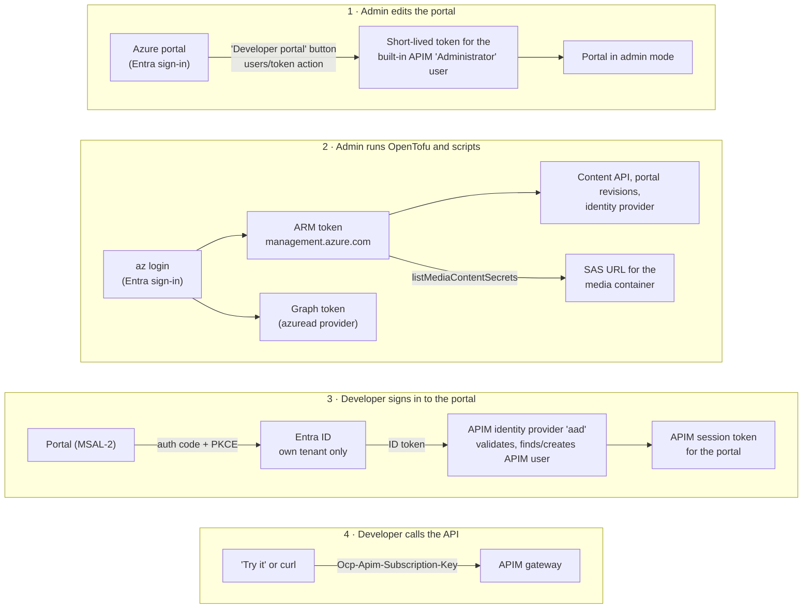

# Reference

Details behind the [README](../README.md).

- [Components](#components)
- [Authentication](#authentication)
- [Permissions](#permissions)
- [Stages and state](#stages-and-state)
- [Portal content and media](#portal-content-and-media)
- [Microsoft's scripts and updates](#microsofts-scripts-and-updates)
- [Make targets](#make-targets)
- [Known quirks](#known-quirks)
- [Repository layout](#repository-layout)

## Components

| Where | Component | Created by |
| --- | --- | --- |
| Entra ID | App registration `apim-dev-portal-poc-portal` (other stages: `…-portal-<stage>`): single tenant, SPA redirect URI `<portal>/signin`, delegated Microsoft Graph `User.Read`, optional `email` claim | `02-portal/entra.tf` |
| Entra ID | Service principal of the app ("Enterprise applications"), optional group assignments | `02-portal/entra.tf` |
| Entra ID | Client secret, 90 days | `02-portal/entra.tf` |
| Entra ID | Users and groups who may sign in | your identity process |
| APIM | Identity provider `aad`: client ID, secret, MSAL-2, sign-in tenant = allowed tenant = your tenant | `02-portal/portal.tf` |
| APIM | Sign-up setting: email/password registration off | `02-portal/main.tf` (`scripts/portal-signup.sh`) |
| APIM | Portal content (pages, layouts, styles, navigation) and media, stored inside APIM | admin mode, `make portal-capture`, `make up-2` |
| APIM | Users and the built-in group `developers`, created on a developer's first sign-in | APIM |
| APIM | Portal revision (the published site) | `scripts/portal-publish.sh` |

## Authentication



1. **Admin edits the portal.** After the Entra sign-in to the Azure portal, the *Developer portal* button asks APIM for a short-lived token for APIM's built-in *Administrator* user (`Microsoft.ApiManagement/service/users/token/action`) and opens admin mode. In the editor, the admin acts as that APIM user.
2. **Admin runs OpenTofu and the scripts.** Everything uses the Azure CLI sign-in: ARM tokens for `management.azure.com` and Graph tokens for the app registration. Media files are read and written through a short-lived SAS URL that APIM hands out (`portalconfigs/default/listMediaContentSecrets`).
3. **Developer signs in.** MSAL-2 (authorization code flow with PKCE) against your tenant only (`AzureADMyOrg` on the app, `allowed_tenants` on the identity provider). APIM validates the token, finds or creates the APIM user (member of `developers`), and the portal continues with an APIM session. On the first sign-in the portal shows a one-time "Complete sign up" form. It is part of the Entra flow and works with email/password sign-up turned off.
4. **Developer calls the API** with the subscription key of their subscription. "Try it" calls the gateway directly from the browser, so the API needs a CORS policy that allows the portal origin and all request headers (the test console may send `Ocp-Apim-Trace` and `Cache-Control`).

## Permissions

| Who | Needs | Scope | Why |
| --- | --- | --- | --- |
| Admin running `make up-2` | API Management Service Contributor | APIM instance | Read the instance, identity provider, sign-up setting, content API, `listMediaContentSecrets`, portal revisions |
| Admin running `make up-2` | Create app registrations: tenant setting "Users can register applications", otherwise **Application Developer** | Entra tenant | App registration, service principal, secret (the admin becomes owner) |
| Admin running `make up-2` with `sign_in_group_ids` | Owner of the app's service principal (automatic), groups need Entra ID P1 | Entra tenant | Group assignments to the enterprise application |
| Admin designing / capturing | API Management Developer Portal Content Editor or API Management Service Contributor | APIM instance | Admin mode (`users/token/action`), read content items and media |
| First open of a new instance ("initialize") | API Management Service Contributor | APIM instance | Creates the default portal content |
| Tenant admin, if user consent is disabled | Cloud Application Administrator | Entra tenant | Admin consent for `User.Read` |
| Developer | Member of the tenant (or allowed group) | Entra tenant | Sign-in; no Azure RBAC |

The scripts were tested with Owner. The Content Editor role is the documented least-privilege role for portal designers, but it was not tested with these scripts.

## Stages and state

| Stage | Instance values | OpenTofu workspace in `02-portal` |
| --- | --- | --- |
| `dev` (default) | `02-portal/stages/dev.tfvars` | `default` |
| any other, e.g. `test`, `prod` | `02-portal/stages/<stage>.tfvars` | `<stage>` |

- Each stage has its own encrypted state, app registration (`…-portal-<stage>`; dev keeps the name without suffix) and secret.
- Stage files can override `subscription_id`, `tenant_id`, `signup_enabled` and `sign_in_group_ids` (see `stages/example.tfvars.example`).
- State is local and encrypted with OpenTofu's native encryption (pbkdf2 + AES-GCM, enforced for state and plan). The passphrase comes from `TF_VAR_state_passphrase` in `.env`. If it is lost, the state can no longer be read; delete the app registrations manually and re-deploy.
- Direct `tofu` commands for a stage other than dev: `tofu -chdir=02-portal workspace select <stage>`, then pass `-var-file=stages/<stage>.tfvars`. Load `.env` first: `set -a; . ./.env; set +a`.

## Portal content and media

```text
02-portal/content/data.json   all content items (sorted and indented for readable diffs)
02-portal/content/media/      uploaded files, named by blob ID, + .info with the content type
```

| Step | What happens |
| --- | --- |
| `make portal-capture` | `capture.js` reads every content item into `data.json` and downloads every media blob (via SAS URL) into `media/`. `media/` is wiped first, so files deleted in the portal disappear from the snapshot. `data.json` is then sorted and indented. |
| `make up-2` | Only if the snapshot changed (hash over `content/`): `cleanup.js` deletes **all** content items and media in the target, `generate.js` recreates them under the same IDs, so pages keep pointing at the right images. Then the portal is published. |
| Publish | Uploaded files are served under their `permalink`, e.g. `https://<portal>/content/<file>`. |

- An uploaded image is two things: a blob in APIM's internal media storage, and a content item of type `blob` (file name, MIME type, permalink) that pages reference.
- The portal's default images are not in `media/`; they load from Microsoft's public storage.
- The snapshot contains no instance-specific values (checked: no host names, client IDs or e-mail addresses), so it works in every stage.
- This follows Microsoft's guidance: [Automate developer portal deployments](https://learn.microsoft.com/azure/api-management/automate-portal-deployments).

## Microsoft's scripts and updates

`capture.js`, `cleanup.js`, `generate.js` and `utils.js` from [`Azure/api-management-developer-portal`](https://github.com/Azure/api-management-developer-portal) (`scripts.v3`, MIT license) are vendored in `tools/portal-content/vendor/`, pinned to a release:

- `vendor/UPSTREAM` records tag and commit, `vendor/LICENSE` is Microsoft's license.
- `package.json` / `package-lock.json` pin the npm dependencies. `scripts/portal-content.sh` runs `npm ci` when needed.
- Why vendored: a clone at runtime follows Microsoft's default branch and can change without notice (the scripts were rewritten from v2 to v3 before). A submodule pulls the whole portal repository for four files.

```bash
make portal-tools-update             # latest release (or REF=<tag>)
git diff tools/portal-content        # review the changes
make portal-capture                  # test against dev; data.json must not change unexpectedly
```

The update script also prints the package versions Microsoft declares for `@azure/storage-blob` and `mime`; align `package.json` if they differ.

## Make targets

| Target | What it does |
| --- | --- |
| `make up-2 [STAGE=dev]` | Deploy the portal part for a stage: Entra app, identity provider, sign-up off, content, publish |
| `make portal-capture [STAGE=dev]` | Export the stage's portal content into `02-portal/content/` |
| `make plan [STAGE=dev]` | Drift check of the portal part, fails on changes |
| `make down-2 [STAGE=dev]` | Remove the portal part of a stage (the last published portal stays visible) |
| `make portal-tools-update [REF=<tag>]` | Update Microsoft's vendored scripts |
| `make lint` | Static checks, no Azure access |
| `make up-1`, `smoke`, `plan-apim`, `down` | Optional demo instance, see [demo-apim.md](demo-apim.md) |

`apply` and `destroy` ask for confirmation; `AUTO_APPROVE=1` skips it.

## Known quirks

- A new instance has no portal content until it is opened once in admin mode (before: 0 pages, after: 16). `make up-2` checks this first.
- The first Entra sign-in attempt may fail with `timed_out` (MSAL); a second attempt works.
- The "Complete sign up" email field stays empty for accounts without the Entra property *Email* (`mail`), e.g. external `#EXT#` accounts.
- `make up-2` re-applies content only when the snapshot changed; to force it: `tofu -chdir=02-portal apply -var-file=stages/<stage>.tfvars -replace='terraform_data.portal_content[0]'`.
- Republish without changes: `-replace=terraform_data.portal_publish`.

## Repository layout

```text
02-portal/               Developer portal: Entra app, identity provider, sign-up, content, publish
  content/               Portal snapshot (data.json + media/)
  stages/                One tfvars file per stage (example.tfvars.example)
01-apim/                 Optional demo APIM instance with a CRUD API (docs/demo-apim.md)
scripts/                 Publish, preflight, sign-up, content capture/apply, smoke test
tools/portal-content/    Microsoft's portal scripts (vendored) + update script
docs/                    Reference and demo documentation
Makefile                 Workflow
```
